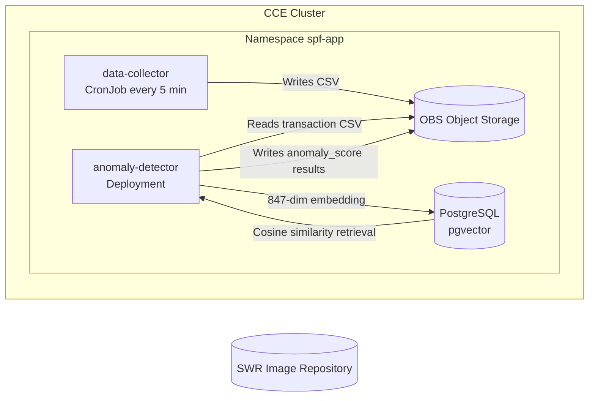

# finance-payment-fraud-detection

[](LICENSE)
[](https://www.huaweicloud.com)

An intelligent payment fraud detection solution based on AI/ML and data analytics: it identifies anomalous transactions through **text vector embeddings + pgvector cosine similarity retrieval**, providing financial institutions with actionable fraud-blocking evidence and data insight capabilities.

## 1. Overview

An intelligent payment fraud detection solution based on AI/ML and data analytics: it identifies anomalous transactions through **text vector embeddings + pgvector cosine similarity retrieval**, providing financial institutions with actionable fraud-blocking evidence and data insight capabilities. A Java collector periodically reads data from the transaction dataset and writes it to object storage; a Python detector generates 847-dimensional embeddings and compares them against the vector store to output anomaly scores, and the results are written back to object storage for analysis and visualization.

## 2. Table of Contents

- [1. Overview](#1-overview)
- [2. Table of Contents](#2-table-of-contents)
- [3. Architecture Diagram](#3-architecture-diagram)
- [4. Highlights](#4-highlights)
- [5. Cloud Services Used](#5-cloud-services-used)
- [6. Prerequisites](#6-prerequisites)
- [7. Quick Start](#7-quick-start)
- [8. Step-by-Step Deployment](#8-step-by-step-deployment)
- [9. Usage / Verification](#9-usage--verification)
- [10. Cleanup](#10-cleanup)
- [11. Detailed Explanation](#11-detailed-explanation)
- [12. Dependencies](#12-dependencies)
- [13. FAQ / Troubleshooting](#13-faq--troubleshooting)
- [14. Contributing](#14-contributing)
- [15. License](#15-license)
- [16. Contact / Maintainers](#16-contact--maintainers)

## 3. Architecture Diagram



**Core flow**: the data collector (Java) periodically reads data from the built-in transaction dataset and writes it to object storage → the anomaly detector (Python) reads the transaction data, uses SentenceTransformer to generate text vectors, concatenates them with numeric/categorical/time features into 847-dimensional embeddings → performs cosine similarity comparison against the preloaded anomalous sample vectors in pgvector and outputs `anomaly_score` (0~1) → the results are written back to object storage for analysis and visualization.

## 4. Highlights

- **AI/ML fraud detection**: SentenceTransformer (all-mpnet-base-v2) text embeddings + pgvector vector similarity retrieval, obtaining semantic-level anomaly signals without calling a large model
- **Containerized microservices**: the Java collector and Python detector are decoupled, with standard CronJob + Deployment scheduling
- **Cloud-native data pipeline**: object storage (OBS) carries transaction data and detection results, PostgreSQL (pgvector) carries the vector store
- **One-command deployment**: Terraform creates cloud resources + scripts build and push images + kubectl deploys applications

## 5. Cloud Services Used

| Cloud Service | Purpose |
|---|---|
| CCE (Cloud Container Engine) | Hosts all microservices (PostgreSQL / collector / detector) |
| OBS (Object Storage Service) | Transaction data, detection results, embeddings data assets |
| SWR (Container Image Service) | Application image hosting |
| IAM agency | Permission channel for CCE nodes to access OBS/SWR |

> Cleanup: after deployment, if no longer needed, release all cloud resources as described in the [Cleanup](#10-cleanup) section to avoid residuals.

## 6. Prerequisites

| Item | Requirement |
|---|---|
| Huawei Cloud account | CCE / OBS / SWR services enabled, with permissions to create VPCs, CCE clusters, and OBS buckets |
| Region | `cn-north-4` (Beijing 4) recommended |
| CLI tools | Terraform >= 1.5, kubectl, docker, obsutil, jq |
| Credentials | environment variables `HW_ACCESS_KEY` / `HW_SECRET_KEY` (AK/SK, least privilege: CCE, OBS, SWR, VPC, IAM) |
| kubeconfig | configured to connect to the CCE cluster (`kubectl config use-context`) |

## 7. Quick Start

```bash
# 1. Enter the infra directory, configure variables and initialize
cd infra
cp terraform.tfvars.example terraform.tfvars   # Modify obs_bucket_name etc.
terraform init && terraform apply

# 2. Get deployment parameters
export OBS_BUCKET=$(terraform output -raw obs_bucket)
export DB_PASSWORD=$(terraform output -raw db_password)

# 3. Build images + deploy the application
cd ..
bash src/scripts/deploy.sh
```

## 8. Step-by-Step Deployment

### 1. Create the Cloud Infrastructure

```bash
cd infra
terraform init
terraform plan        # Confirm the resource list
terraform apply       # Create VPC / CCE cluster / node pool / OBS bucket / SWR repository / IAM agency
```

Expected output: `Apply complete! Resources: N added, 0 changed, 0 destroyed.`, and outputs such as `cluster_name` and `obs_bucket` are printed.

### 2. Configure kubeconfig

Download kubeconfig from the CCE console → Cluster → Connection Info, or obtain it with a CLI tool:

```bash
# Option 1: after downloading kubeconfig from the console
export KUBECONFIG=/path/to/kubeconfig
kubectl get nodes   # Nodes in the node pool should appear Ready

# Option 2: obtain via CLI
# huaweicloud cce show-cluster-kubeconfig ... (follow the CLI documentation)
```

### 3. Upload Data Assets and Deploy the Application

```bash
export HW_ACCESS_KEY=xxx HW_SECRET_KEY=xxx   # For SWR login + OBS upload
bash src/scripts/deploy.sh
```

The script automatically: uploads embeddings data to OBS → builds and pushes 3 images to SWR → renders manifests → deploys PostgreSQL / anomaly-detector / data-collector.

## 9. Usage / Verification

After deployment, verify that the fraud detection pipeline works using the following steps:

```bash
NAMESPACE=spf-app

# 1. Confirm all workloads are ready
kubectl -n $NAMESPACE get pods
# Expected: postgres-0 Running, anomaly-detector-xxx Running/Init:1/2 then Running,
#           data-collector CronJob created

# 2. Confirm vector store initialization is complete (init container ran embeddings_loader)
kubectl -n $NAMESPACE logs -l app=anomaly-detector-app -c anomaly-detector-init --tail=50
# Expected output includes: Database 'payments' created / Creating tables and inserting data... / Success!

# 3. Trigger a collection (wait for CronJob scheduling or create a Job manually)
kubectl -n $NAMESPACE create job --from=cronjob/data-collector manual-collect-1
kubectl -n $NAMESPACE logs job/manual-collect-1 --tail=30
# Expected output includes: Read total of 5000 lines ... Stored at ... data-collector/...

# 4. View the anomaly detection output (after the detector runs)
kubectl -n $NAMESPACE logs -l app=anomaly-detector-app --tail=30
# Expected output includes: File 'data-collector/.../file.csv' processed in X seconds
#              Scored file saved as 'anomaly-detector/..._scored.csv'

# 5. Confirm the detection results are in object storage
obsutil ls obs://<OBS_BUCKET>/anomaly-detector/ --limit 5
# Expected: *_scored.csv files are visible, containing the anomaly_score column
```

**Acceptance criteria**: Step 2 vector loading succeeded + Step 3 collection file succeeded + Step 4 detection completed + Step 5 result file readable = the end-to-end pipeline works.

After deployment, follow these steps to verify that the business functionality works before considering the delivery complete.

## 10. Cleanup

```bash
# 1. Clean up in-cluster resources
bash src/scripts/cleanup.sh

# 2. Destroy the cloud infrastructure (VPC / CCE / OBS / SWR)
cd infra && terraform destroy
```

> Note: ensure Kubernetes resources are cleaned up before destroying the CCE cluster; the OBS bucket has `force_destroy=true` and will be emptied automatically.

## 11. Detailed Explanation

### Workflow

| Stage | Component | Description |
|---|---|---|
| Data collection | data-collector (Java CronJob) | Every 5 minutes reads 5000 rows from the built-in CSV dataset, normalizes timestamps and writes to object storage `data-collector/YYYY/MM/DD/HH/MM/SS/file.csv`, maintaining a row-number cursor state file |
| Vector loading | anomaly-detector init container | Downloads pre-generated embeddings CSV from object storage, creates the database and tables (pgvector extension + `vector(847)`), bulk-loads via COPY |
| Anomaly detection | anomaly-detector (Python Deployment) | Reads transaction CSV → feature engineering (numeric standardization + categorical one-hot + timestamp splitting + text vectors) → 847-dimensional embedding → cosine similarity against the anomaly sample store → writes `anomaly_score` back to `anomaly-detector/` |
| Data insight | OBS result files | Detection result CSVs can be read directly by downstream BI visualization / analysis tools |

### Key Configuration

| Config Item | Location | Description |
|---|---|---|
| Collection frequency / row count | `src/manifests/data-collector.yaml` ConfigMap | `schedule`, `max_lines_to_read` |
| Vector dimension | `src/app/anomaly-detector/embeddings_loader.py` / `anomaly_detector.py` | `vector(847)`, must match on both sides |
| Object storage paths | `src/manifests/anomaly-detector.yaml` ConfigMap | `OBS_PATH_INPUT` (input) / `OBS_PATH_OUTPUT` (output) |
| Node flavor / count | `infra/main.tf` | `node_flavor` / `node_count` |

### API and Data Formats

- Collected data CSV columns: `EVENT_TIMESTAMP, LABEL_TIMESTAMP, order_price, billing_zip, billing_latitude, billing_longitude, billing_state, billing_country, product_category, customer_name, billing_city, billing_street, customer_email, billing_phone, ip_address`
- Detection output: input columns + `anomaly_score` (0~1, closer to 1 means more anomalous)

## 12. Dependencies

| Dependency | Version | Purpose |
|------|------|------|
| Terraform | >= 1.5 | Infrastructure orchestration |
| huaweicloud Provider | ~> 1.70 | Huawei Cloud resource provisioning |
| hashicorp/random Provider | ~> 3.6 | Random suffixes for resource names |
| Python + SentenceTransformer | all-mpnet-base-v2 | Transaction text vector embeddings |
| PostgreSQL + pgvector | vector(847) | Anomaly sample vector store |
| Java | — | Transaction data collector |

## 13. FAQ / Troubleshooting

**Q: How do I adjust the anomaly threshold?**
A: Modify the similarity threshold parameter in the anomaly-detector configuration and redeploy the Deployment.

**Q: How do I scale up the vector store?**
A: Adjust the storage specification of the PostgreSQL instance and the pgvector index parameters; see `docs/architecture.md`.

## 14. Contributing

Issues and Pull Requests are welcome. When changing detection logic or feature engineering, please include evaluation data; infrastructure changes must pass `terraform validate` and update the `docs/` documentation accordingly.

## 15. License

This practice is licensed under **MIT No Attribution**; see [LICENSE](LICENSE).

## 16. Contact / Maintainers
| Item | Content |
|---|---|
| **Creator** | [dgc-git](https://github.com/dgc-git) |
| **Maintainer** | [dgc-git](https://github.com/dgc-git) |
| **Contact** | GitHub Issues / PR (see [Section 14](#14-contributing)) |
