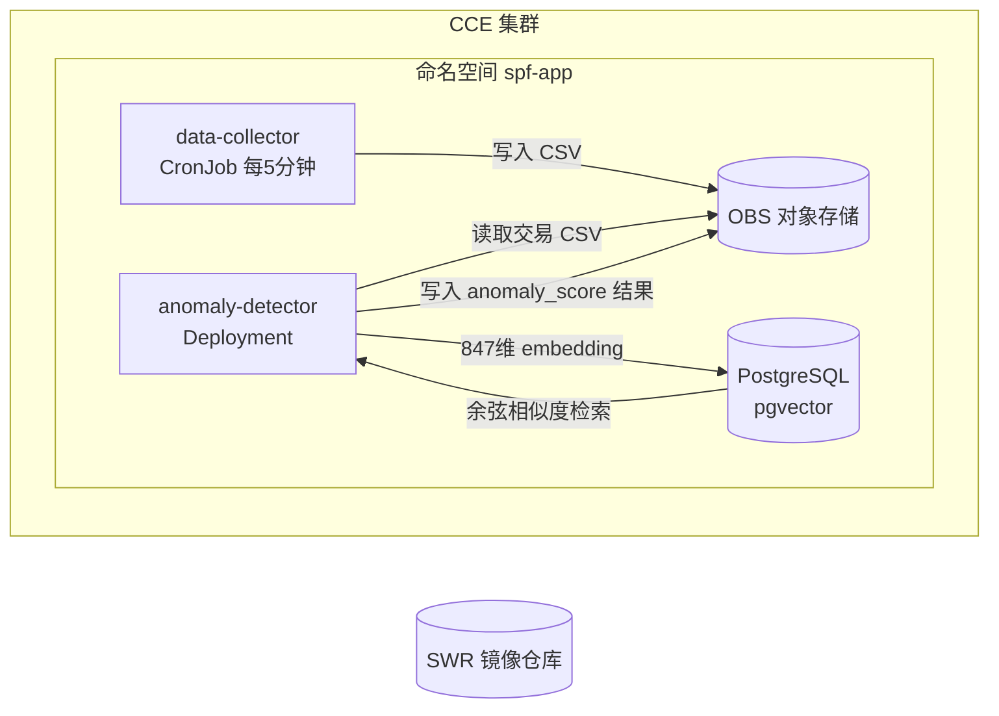

# finance-payment-fraud-detection · 支付欺诈检测 · AI/ML 与数据洞察

[](LICENSE)
[](https://www.huaweicloud.com)
基于 AI/ML 与数据分析的智能支付欺诈检测方案：通过**文本向量嵌入 + pgvector 余弦相似度检索**识别异常交易，为金融机构提供可执行的欺诈拦截依据与数据洞察能力。

## 1. 简介 / Overview

### 简介


基于 AI/ML 与数据分析的智能支付欺诈检测方案：通过**文本向量嵌入 + pgvector 余弦相似度检索**识别异常交易，为金融机构提供可执行的欺诈拦截依据与数据洞察能力。Java 采集器定时从交易数据集读取数据写入对象存储，Python 检测器生成 847 维 embedding 并与向量库比对输出异常评分，结果写回对象存储供分析与可视化。

---

## 2. 目录


- [1. 简介 / Overview](#1-简介--overview)
- [2. 目录](#2-目录)
- [3. 架构图](#3-架构图)
- [4. 方案亮点](#4-方案亮点)
- [5. 涉及云服务](#5-涉及云服务)
- [6. 前置条件](#6-前置条件)
- [7. 快速开始](#7-快速开始)
- [8. 分步部署](#8-分步部署)
- [9. 使用方法 / 验证](#9-使用方法--验证)
- [10. 清理资源](#10-清理资源)
- [11. 详细说明](#11-详细说明)
- [12. 依赖](#12-依赖)
- [13. FAQ / 故障排除](#13-faq--故障排除)
- [14. 贡献指南](#14-贡献指南)
- [15. 许可证](#15-许可证)
- [16. 联系方式 / 维护者](#16-联系方式--维护者)


---

## 3. 架构图



**核心流程**：数据采集器（Java）定时从内置交易数据集读取数据写入对象存储 → 异常检测器（Python）读取交易数据，用 SentenceTransformer 生成文本向量并与数值/类别/时间特征拼接为 847 维 embedding → 与 pgvector 中预载的异常样本向量做余弦相似度比对，输出 `anomaly_score`（0~1）→ 结果写回对象存储供分析与可视化。

---

## 4. 方案亮点

- **AI/ML 欺诈检测**：SentenceTransformer（all-mpnet-base-v2）文本嵌入 + pgvector 向量相似度检索，无需大模型调用即可获得语义级异常信号
- **容器化微服务**：Java 采集器与 Python 检测器解耦，CronJob + Deployment 标准调度
- **云原生数据链路**：对象存储（OBS）承载交易数据与检测结果，PostgreSQL(pgvector) 承载向量库
- **一键部署**：Terraform 建云资源 + 脚本构建推送镜像 + kubectl 部署应用

---

## 5. 涉及云服务

| 云服务 | 用途 |
|---|---|
| CCE（云容器引擎） | 承载全部微服务（PostgreSQL / 采集器 / 检测器） |
| OBS（对象存储服务） | 交易数据、检测结果、embeddings 数据资产 |
| SWR（容器镜像服务） | 应用镜像托管 |
| IAM 委托 | CCE 节点访问 OBS/SWR 的权限通道 |

> 清理资源：部署完成后如不再使用，请按[清理资源](#清理资源)章节释放全部云资源，避免残留。

---

## 6. 前置条件

| 项 | 要求 |
|---|---|
| 华为云账号 | 已开通 CCE / OBS / SWR 服务，具备创建 VPC、CCE 集群、OBS 桶权限 |
| 区域 | 推荐 `cn-north-4`（北京四） |
| CLI 工具 | Terraform ≥ 1.5、kubectl、docker、obsutil、jq |
| 凭据 | 环境变量 `HW_ACCESS_KEY` / `HW_SECRET_KEY`（AK/SK，最小权限：CCE、OBS、SWR、VPC、IAM） |
| kubeconfig | 已配置连接 CCE 集群（`kubectl config use-context`） |

---

## 7. 快速开始

```bash
# 1. 进入 infra 目录，配置变量并初始化
cd infra
cp terraform.tfvars.example terraform.tfvars   # 修改 obs_bucket_name 等
terraform init && terraform apply

# 2. 获取部署参数
export OBS_BUCKET=$(terraform output -raw obs_bucket)
export DB_PASSWORD=$(terraform output -raw db_password)

# 3. 构建镜像 + 部署应用
cd ..
bash src/scripts/deploy.sh
```

---

## 8. 分步部署

### 1. 创建云基础设施

```bash
cd infra
terraform init
terraform plan        # 确认资源清单
terraform apply       # 创建 VPC / CCE 集群 / 节点池 / OBS 桶 / SWR 仓库 / IAM 委托
```

预期输出：`Apply complete! Resources: N added, 0 changed, 0 destroyed.`，并打印 `cluster_name`、`obs_bucket` 等输出。

### 2. 配置 kubeconfig

在 CCE 控制台 → 集群 → 连接信息中下载 kubeconfig，或使用命令行工具获取：

```bash
# 方式一：控制台下载 kubeconfig 后
export KUBECONFIG=/path/to/kubeconfig
kubectl get nodes   # 应看到节点池内节点 Ready

# 方式二：CLI 获取
# huaweicloud cce show-cluster-kubeconfig ...（按 CLI 文档执行）
```

### 3. 上传数据资产并部署应用

```bash
export HW_ACCESS_KEY=xxx HW_SECRET_KEY=xxx   # SWR 登录 + OBS 上传用
bash src/scripts/deploy.sh
```

脚本自动完成：embeddings 数据上传 OBS → 构建并推送 3 个镜像到 SWR → 渲染 manifest → 部署 PostgreSQL / anomaly-detector / data-collector。

---

## 9. 使用方法 / 验证

### 使用方法/验证


部署完成后，按以下步骤验证欺诈检测链路是否可用：

```bash
NAMESPACE=spf-app

# 1. 确认所有工作负载就绪
kubectl -n $NAMESPACE get pods
# 预期：postgres-0 Running、anomaly-detector-xxx Running/Init:1/2 后变 Running、
#       data-collector CronJob 已创建

# 2. 确认向量库初始化完成（init 容器跑完 embeddings_loader）
kubectl -n $NAMESPACE logs -l app=anomaly-detector-app -c anomaly-detector-init --tail=50
# 预期输出包含：Database 'payments' created / Creating tables and inserting data... / Success!

# 3. 触发一次采集（等 CronJob 调度或手动创建 Job）
kubectl -n $NAMESPACE create job --from=cronjob/data-collector manual-collect-1
kubectl -n $NAMESPACE logs job/manual-collect-1 --tail=30
# 预期输出包含：Read total of 5000 lines ... Stored at ... data-collector/...

# 4. 查看异常检测输出（检测器运行后）
kubectl -n $NAMESPACE logs -l app=anomaly-detector-app --tail=30
# 预期输出包含：File 'data-collector/.../file.csv' processed in X seconds
#              Scored file saved as 'anomaly-detector/..._scored.csv'

# 5. 确认检测结果已落对象存储
obsutil ls obs://<OBS_BUCKET>/anomaly-detector/ --limit 5
# 预期：看到 *_scored.csv 文件，含 anomaly_score 列
```

**验收标准**：步骤 2 向量加载成功 + 步骤 3 采集文件成功 + 步骤 4 检测完成 + 步骤 5 结果文件可读 = 端到端链路可用。

---

## 10. 清理资源

```bash
# 1. 清理集群内资源
bash src/scripts/cleanup.sh

# 2. 销毁云基础设施（VPC / CCE / OBS / SWR）
cd infra && terraform destroy
```

> 提示：CCE 集群销毁前确保 k8s 资源已清理；OBS 桶 `force_destroy=true` 会自动清空对象。

---

## 11. 详细说明

### 工作流程

| 阶段 | 组件 | 说明 |
|---|---|---|
| 数据采集 | data-collector（Java CronJob） | 每 5 分钟从内置 CSV 数据集读取 5000 行，时间戳归一化后写入对象存储 `data-collector/YYYY/MM/DD/HH/MM/SS/file.csv`，并维护行号游标状态文件 |
| 向量加载 | anomaly-detector init 容器 | 从对象存储下载预生成的 embeddings CSV，建库建表（pgvector 扩展 + `vector(847)`），COPY 批量入库 |
| 异常检测 | anomaly-detector（Python Deployment） | 读取交易 CSV → 特征工程（数值标准化 + 类别 one-hot + 时间戳拆分 + 文本向量）→ 847 维 embedding → 与异常样本库余弦相似度 → `anomaly_score` 写回 `anomaly-detector/` 目录 |
| 数据洞察 | OBS 结果文件 | 检测结果 CSV 可供后续 BI 可视化 / 分析工具直接读取 |

### 关键配置

| 配置项 | 位置 | 说明 |
|---|---|---|
| 采集频率/行数 | `src/manifests/data-collector.yaml` ConfigMap | `schedule`、`max_lines_to_read` |
| 向量维度 | `src/app/anomaly-detector/embeddings_loader.py` / `anomaly_detector.py` | `vector(847)`，两侧必须一致 |
| 对象存储路径 | `src/manifests/anomaly-detector.yaml` ConfigMap | `OBS_PATH_INPUT`（输入）/ `OBS_PATH_OUTPUT`（输出） |
| 节点规格/数量 | `infra/main.tf` | `node_flavor` / `node_count` |

### API 与数据格式

- 采集数据 CSV 列：`EVENT_TIMESTAMP, LABEL_TIMESTAMP, order_price, billing_zip, billing_latitude, billing_longitude, billing_state, billing_country, product_category, customer_name, billing_city, billing_street, customer_email, billing_phone, ip_address`
- 检测输出：输入列 + `anomaly_score`（0~1，越接近 1 越异常）

---

## 12. 依赖

| 依赖 | 版本 | 用途 |
|------|------|------|
| Terraform | >= 1.5 | 基础设施编排 |
| huaweicloud Provider | ~> 1.70 | 华为云资源供给 |
| hashicorp/random Provider | ~> 3.6 | 资源名随机后缀 |
| Python + SentenceTransformer | all-mpnet-base-v2 | 交易文本向量嵌入 |
| PostgreSQL + pgvector | vector(847) | 异常样本向量库 |
| Java | — | 交易数据采集器 |

---

## 13. FAQ / 故障排除

### FAQ


**Q: 如何调整异常判定阈值？**
A: 修改 anomaly-detector 配置中的相似度阈值参数，重新部署 Deployment 生效。

**Q: 向量库如何扩容？**
A: 调整 PostgreSQL 实例的存储规格与 pgvector 索引参数，详见 `docs/architecture.md`。

---

## 14. 贡献指南

欢迎提交 Issue 与 Pull Request。修改检测逻辑或特征工程时请附带评测数据说明；基础设施变更需通过 `terraform validate` 并同步更新 `docs/` 文档。

---

## 15. 许可证

本实践采用 **MIT No Attribution** 许可证，详见 [LICENSE](LICENSE)。

---

## 16. 联系方式 / 维护者
| 项 | 内容 |
|---|---|
| **创建者** | [dgc-git](https://github.com/dgc-git) |
| **维护者** | [dgc-git](https://github.com/dgc-git) |
| **联系方式** | GitHub Issues / PR（见[第 14 节](#14-贡献指南)） |
