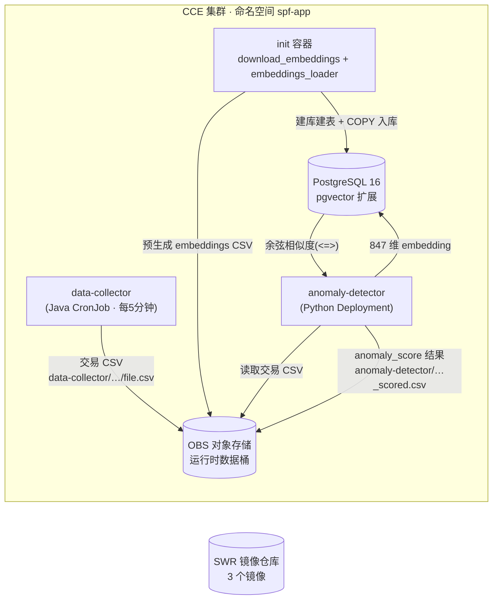

# 架构说明（Architecture）

## 概述

本方案为金融机构提供**智能支付欺诈检测**能力：采用「文本向量嵌入 + 向量相似度检索」的机器学习路径，对每笔交易生成 847 维特征向量，与已知异常交易向量库做余弦相似度比对，输出 0~1 的异常评分，供风控决策使用。全链路运行于容器集群，数据经由对象存储流转，组件间松耦合、可独立扩缩容。

## 总体架构



## 组件说明

### 1. 数据采集器（data-collector）

- **形态**：Java 11 微服务，以 CronJob 每 5 分钟调度一次
- **职责**：从内置交易数据集（`transaction_data_100K_full.csv`，随镜像打包）按行号游标分段读取，将时间戳归一化（UTC 递增），写入对象存储 `data-collector/YYYY/MM/DD/HH/MM/SS/file.csv`
- **状态管理**：采集进度（行号游标）持久化到对象存储 `collector-state.txt`，任务重启后从上次位置继续，保证不重不漏
- **存储访问**：通过 OBS SDK（esdk-obs-java）访问对象存储；凭据来自环境变量（k8s Secret 注入）或节点 IAM 委托

### 2. 异常检测器（anomaly-detector）

- **形态**：Python 3.10 微服务，Deployment 长驻
- **init 容器**：两步初始化
  1. `download_embeddings.py`：从对象存储下载 4 个预生成 embeddings CSV（异常样本 + 交易样本向量）
  2. `embeddings_loader.py`：连接 PostgreSQL，创建 `vector` 扩展与 `transaction` / `transaction_anomalies` 两张 `vector(847)` 表，批量 COPY 入库（幂等：已有数据则跳过）
- **主容器**：核心检测流程
  1. 从对象存储读取采集器产出的交易 CSV
  2. **特征工程**：数值特征（billing_zip / 经纬度 / order_price）标准化；类别特征（state / country / category）one-hot；时间戳拆分为年/月/日/时/分/秒；文本特征（姓名/城市/街道/邮箱/电话/IP）经 SentenceTransformer（all-mpnet-base-v2）编码为 768 维向量
  3. 拼接为 **847 维 embedding**（79 维结构化特征 + 768 维文本向量）
  4. 对每个交易向量执行 `SELECT MAX(1 - (embedding <=> %s::vector)) FROM transaction_anomalies` 余弦相似度检索
  5. 结果以 `anomaly_score`（0~1）列附加到数据集，写回 `anomaly-detector/…_scored.csv`
- **运行时发现**：通过 Kubernetes API 读取 ConfigMap 获取配置（数据库地址、对象存储桶名、路径前缀），无需重启即可调整

### 3. 向量数据库（PostgreSQL + pgvector）

- **形态**：单实例 StatefulSet + Headless Service（PVC 持久化）
- **扩展**：pgvector 提供 `vector` 类型与 `<=>`（余弦距离）运算符，支撑 847 维向量的近似检索
- **表结构**：
  - `transaction`：正常交易向量库（约 10 万条）
  - `transaction_anomalies`：已知异常交易向量库（作为相似度比对基准）

### 4. 对象存储（OBS）

| 前缀 | 内容 | 读写方 |
|---|---|---|
| `embeddings/` | 预生成 embeddings CSV（数据资产，部署时上传） | init 容器读 |
| `data-collector/` | 采集器产出的交易 CSV + 状态文件 | 采集器写 / 检测器读 |
| `anomaly-detector/` | 检测结果 `*_scored.csv` | 检测器写 |

### 5. 镜像仓库（SWR）

| 镜像 | 说明 |
|---|---|
| `postgres-pgvector` | PostgreSQL 16 + pgvector 扩展 |
| `anomaly-detector` | Python 检测器（含下载/加载/检测脚本） |
| `data-collector` | Java 采集器（内置交易数据集） |

## 数据流与时序

```
t0        CronJob 触发 → 采集器读 5000 行 → 写 OBS data-collector/…/file.csv → 更新游标
t0+部署    init 容器 → 下载 embeddings → 建库建表 → COPY 10 万+向量入 pgvector
运行期    检测器轮询 OBS data-collector/ 新 CSV → 特征工程 → 847 维向量 → 相似度检索 → 写回 OBS
洞察      *_scored.csv 供 BI / 数据分析工具消费
```

## 安全与隔离

- 命名空间 `spf-app` 内网互通，对象存储同区域内网服务网络访问（免公网）
- 数据库凭据经 k8s Secret 注入（Terraform `random_password` 生成，不落盘明文）
- 对象存储凭据可选：节点 IAM 委托（推荐）或 k8s Secret 环境变量
- 容器资源限制：检测器 3C/6Gi 上限，数据库 2C/4Gi 上限

## 扩展方向

- 向量库高可用：PostgreSQL 可切换为双副本部署或托管数据库
- 数据洞察：OBS 结果文件可接入 DLI 数据目录建表，配合可视化工具产出风控报表
- 检测频率：CronJob 调度周期、单批行数均可通过 ConfigMap 调整
